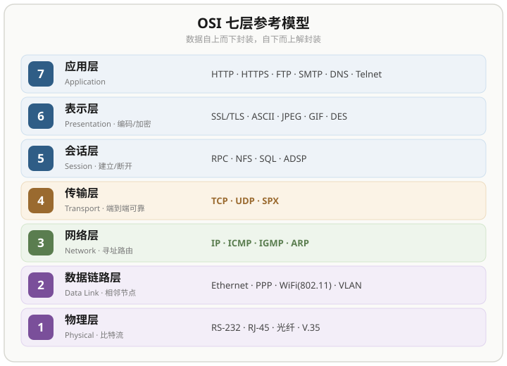

# 网络七层架构（OSI 模型）

OSI（Open System Interconnection）参考模型把网络通信拆成 7 层，每层只负责自己的事、并向上层提供服务。数据发送时**自上而下逐层封装**，接收时**自下而上逐层解封装**。

## 一、逐层理解

可以把寄快递当类比：

| 层 | 名称 | 职责 | 类比 |
|---|---|---|---|
| 7 | 应用层 | 直接面向应用的接口 | 收件员，按需求提供不同服务 |
| 6 | 表示层 | 数据格式转换、加密/压缩 | 把信件翻译成对方看得懂的语言 |
| 5 | 会话层 | 建立、管理、断开会话 | 通话的接通与挂断 |
| 4 | 传输层 | 端到端可靠/高效传输 | 选择快递公司（顺丰/平邮） |
| 3 | 网络层 | 寻址与路由，送到目标地址 | 规划运输路线 |
| 2 | 数据链路层 | 相邻节点间的帧传输、纠错 | 一个中转站到下一个 |
| 1 | 物理层 | 比特流与电/光信号的转换 | 公路、铁轨等物理通道 |

> 记忆口诀（自上而下）：**应表会传网数物**。

## 二、各层典型协议

- **应用层**：HTTP、HTTPS、FTP、SMTP、DNS、Telnet
- **表示层**：SSL/TLS、ASCII、JPEG、GIF、DES、MPEG
- **会话层**：RPC、NFS、SQL、ADSP
- **传输层**：TCP、UDP、SPX
- **网络层**：IP、ICMP、IGMP、ARP/RARP、IPX
- **数据链路层**：Ethernet、PPP、HDLC、ATM、WiFi(IEEE 802.11)、VLAN、STP
- **物理层**：RS-232/422/485、RJ-45、光纤、V.24/V.35、X.21

## 三、传输层：TCP vs UDP

最常打交道的就是传输层。两者取舍是"可靠"与"快"的权衡：

| | TCP | UDP |
|---|---|---|
| 连接 | 面向连接（三次握手） | 无连接 |
| 可靠性 | 可靠、有序、不丢不重 | 尽最大努力，可能丢/乱序 |
| 速度 | 较慢（确认、重传、拥塞控制） | 快、开销小 |
| 适用 | 网页、文件、邮件、登录 | 视频/语音、直播、游戏、DNS |

- **TCP**：传数据前先建立连接、结束后释放，提供可靠的全双工信道，不易丢包或读到脏数据。
- **UDP**：发数据前无需建立连接，不做拥塞控制，不保证可靠交付，容易丢包、读到脏数据，但延迟低。

代码层面的 socket 实战见 [TCP / UDP 通信](tcp-udp-含粘包与丢包.html)。

## 四、常见协议与默认端口

| 协议 | 端口 | 说明 |
|---|---|---|
| FTP | 21 | 文件传输 |
| SSH | 22 | 安全远程登录 |
| Telnet | 23 | 远程控制（明文） |
| SMTP | 25 | 发邮件 |
| DNS | 53 | 域名解析 |
| HTTP | 80 | 超文本传输 |
| HTTPS | 443 | HTTP + SSL/TLS，传输加密 + 身份认证 |

- **IP**（Internet Protocol）：网络互连协议，含 IPv4 / IPv6。
- **HTTPS**：在 HTTP 下加入 SSL/TLS，安全基础是 SSL，保证传输过程的机密性与完整性。
- **RS-232**：常用串行通信接口标准（EIA RS-232），定义 DTE 与 DCE 间的串行二进制数据交换，工业现场常见，详见 [串口通信](串口通信-rs-232-422-485.html)。

## 五、OSI 与 TCP/IP 模型对应

实际工程中更常用精简的 TCP/IP 四层模型：

| OSI 七层 | TCP/IP 四层 |
|---|---|
| 应用 / 表示 / 会话 | 应用层 |
| 传输 | 传输层（TCP/UDP） |
| 网络 | 网际层（IP） |
| 数据链路 / 物理 | 网络接口层 |

OSI 是**理论参考模型**，分层清晰、便于教学与排错；TCP/IP 是**事实标准**，是互联网真正运行的协议栈。

---

**延伸阅读**：[网络七层结构详解（百度百家号）](https://baijiahao.baidu.com/s?id=1735027686998132611) · 工业总线见 [Modbus](modbus-协议.html) / [CAN](can-总线.html)
