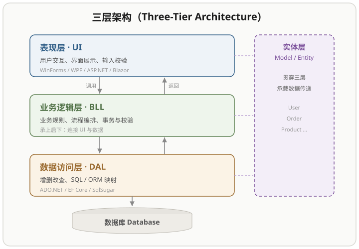

# 三层架构与项目分层

三层架构（Three-Tier Architecture）是经典的分层思想：把系统按职责切成**表现层、业务逻辑层、数据访问层**，每层只依赖下一层、对上层提供服务。目标是**高内聚、低耦合**——某一层改动尽量不波及其他层。



## 一、三层职责

| 层 | 英文 | 职责 | 不该做 |
|---|---|---|---|
| 表现层 | UI / Presentation | 界面展示、接收输入、调用业务层 | 写业务规则、直接连数据库 |
| 业务逻辑层 | BLL | 业务规则、流程编排、事务、校验 | 关心界面长什么样、写 SQL |
| 数据访问层 | DAL | 增删改查、SQL/ORM 映射 | 掺业务判断 |

**依赖方向是单向的**：UI → BLL → DAL → 数据库。下层不应反向依赖上层。

## 二、实体层（Model）

实体层不算"第四层"，而是**贯穿三层的数据载体**。它定义与数据库表对应的对象（POCO），在各层之间传递数据，避免到处用 `DataTable`、零散参数。

```csharp
// Model 层
public class User
{
    public int Id { get; set; }
    public string UserName { get; set; } = "";
    public string Password { get; set; } = "";
}
```

## 三、各层代码示意

```csharp
// DAL：只管数据存取
public class UserDal
{
    public User? GetByName(string name)
    {
        // ADO.NET / EF Core 查询，返回实体
        // ...
        return user;
    }
}

// BLL：业务规则在这里
public class UserBll
{
    private readonly UserDal _dal = new();

    public bool Login(string name, string pwd)
    {
        var user = _dal.GetByName(name);
        if (user is null) return false;
        return user.Password == Encrypt(pwd);   // 业务校验
    }
    private string Encrypt(string s) => /* 加密 */ s;
}

// UI：只负责交互，调用 BLL
private void btnLogin_Click(object sender, EventArgs e)
{
    var bll = new UserBll();
    if (bll.Login(txtName.Text, txtPwd.Text))
        MessageBox.Show("登录成功");
    else
        MessageBox.Show("用户名或密码错误");
}
```

UI 完全不知道数据是怎么存的，DAL 也完全不知道有没有界面——这正是分层的价值。

## 四、典型解决方案目录

```text
MySolution/
├── MyApp.UI/        ← 表现层（WinForms / WPF / Web）
├── MyApp.BLL/       ← 业务逻辑层
├── MyApp.DAL/       ← 数据访问层
├── MyApp.Model/     ← 实体层（被各层共同引用）
└── MyApp.Common/    ← 公共工具（日志、加密、扩展方法）
```

每层一个独立类库，通过项目引用串联；上层引用下层，`Model` 被所有层引用。

## 五、优点与代价

**优点**

- 职责清晰，便于团队分工与维护；
- 可替换性强：换数据库只动 DAL，换界面只动 UI；
- 可测试：BLL 不依赖界面，能单独写单元测试。

**代价**

- 小项目会显得"过度设计"，简单 CRUD 也要穿三层；
- 层间数据传递有一定样板代码；
- 分层不等于解耦——若 UI 直接 `new` 出具体 DAL，仍是强耦合。**进一步用接口 + 依赖注入**反转依赖，见 [设计模式速记](设计模式十一讲-c-版.html) 与 [C# 抽象类、接口](c-抽象类-接口-密封类-部分类.html)。

## 六、何时用 / 不用

- ✅ 中大型业务系统、多人协作、需求会持续演进；
- ⚠️ 一次性脚本、极简工具：直接两层甚至单层即可，别为分层而分层；
- 现代演进方向：在三层基础上引入仓储模式（Repository）、依赖注入容器，乃至向整洁架构 / DDD 分层发展。

## 速记

- 三层：UI → BLL → DAL，**单向依赖**，下层不依赖上层。
- 实体层（Model）贯穿三层做数据载体。
- 分层为了"改一处不动全身"；用**接口 + DI** 才能真正解耦。

---

**延伸阅读**：[C# 项目分层（三层架构）— 知乎](https://zhuanlan.zhihu.com/p/619736083)
